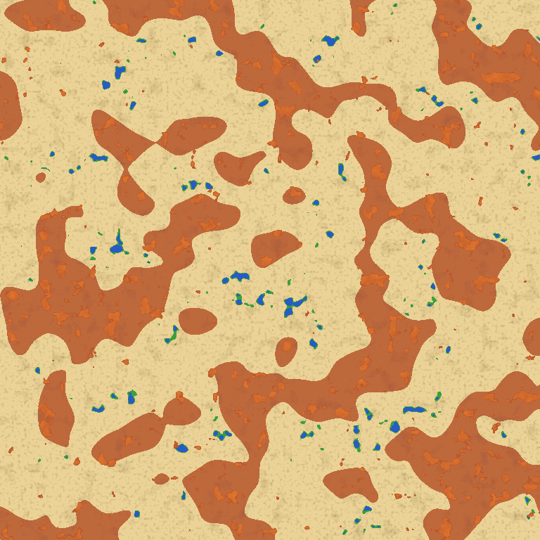

# 大陸横断ホースレース（Minecraft 統合版アドオン / デモ版 v1.0.0）

『スティール・ボール・ラン』に着想を得た、**砂漠を馬で横断するチェックポイント制のバトルレース**です。
ランダムに決まるチェックポイントを順番に目指し、到達順でポイントを獲得。ゴール時点で最もポイントの高いランナーが優勝です。
道中では他のランナーを倒すこともでき、撃破ボーナスが入ります。

> 非公式のファンメイド作品です。原作の名称・キャラクター・画像は使用していません。



*地形のプレビュー（上から見た図・約6000ブロック四方）。黄土色＝砂漠と砂丘 / 赤茶＝赤い砂の荒野 / 明るいオレンジ＝メサ / 青＝オアシスの池 / 緑＝オアシスの草地*

---

## 配布ファイル

| ファイル | 内容 |
| --- | --- |
| [`dist/HorseRace_DesertWorld_v1.0.0.mctemplate`](dist/HorseRace_DesertWorld_v1.0.0.mctemplate) | **おすすめ**。砂漠の平坦ワールド＋アドオンが最初から入ったワールドテンプレート |
| [`dist/HorseRace_v1.0.0.mcaddon`](dist/HorseRace_v1.0.0.mcaddon) | アドオン単体（ビヘイビアパック＋リソースパック） |

### 動作環境

- Minecraft 統合版 **1.21.100 以降**（Script API `@minecraft/server` 2.1.0 / `@minecraft/server-ui` 2.0.0）
- 実験的機能（ベータAPIなど）は **不要**。チートをオフにしたままサバイバルで遊べます
- マルチプレイ対応（ワールドを最初に開いたプレイヤーが「主催者」になります）

---

## 導入方法

### A. ワールドテンプレートで遊ぶ（おすすめ）

1. `HorseRace_DesertWorld_v1.0.0.mctemplate` を開く（ダブルクリック、またはファイルアプリで「Minecraftで開く」）と取り込まれます。
2. マイクラで「遊ぶ」→「新しく作成」→「テンプレート」から **大陸横断ホースレース（砂漠ワールド）** を選んでワールドを作成します。
3. 砂漠バイオームの平坦なワールド（地表は砂、その下に砂岩・石）が生成され、プレイヤーの周りから砂丘・メサ・オアシスのある地形に変わっていきます。座標表示は最初からオンです。

### B. アドオンを自分のワールドに入れる

1. `HorseRace_v1.0.0.mcaddon` を開いて取り込みます。
2. ワールド作成画面で **ワールドタイプを「フラット」** にし、「ビヘイビアパック」と「リソースパック」で *大陸横断ホースレース* を有効にします（片方を有効にするともう片方も自動で入ります）。
3. 草原のフラットワールドが、プレイヤーの周りから自動で砂漠に変わります（草→砂、土→砂岩）。
   - バイオームは平原のままなので、レース開始時に天気を晴れにして天候サイクルを止めています。
   - 草原のフラットワールドは地表が低い（Y=-61）ため、スライムが湧きやすいです。気になる場合はテンプレート（地表Y=63）がおすすめです。
   - 通常（無限）ワールドにも入れられますが、その場合は地形を変更しません。

---

## 主催者の準備

ワールドに最初に入ったプレイヤーが主催者になり、**「レース設定の書」** を受け取ります。
（なくした場合や、OP権限を持つプレイヤーは `/hrace:book` で入手できます）


*左から：レース設定の書 / 拍車（加速アップ） / 手綱（加速ダウン）*

| 操作 | 内容 |
| --- | --- |
| 設定の書を **使う**（右クリック / 長押し） | 主催者メニューを開く |
| 設定の書で **チェストをタップ** | そのチェストの中身を「ショップ」「スタート支給品」「到達報酬」として登録 |
| 設定の書を持って **商人をタップ** | 商人の管理（売るショップの指定・撤去） |

### 1. ショップ（商人が売る品物）を登録する

チェストにアイテムを次のように並べ、設定の書でタップして「新しいショップとして登録」を選びます。
**各「列」が1つの取引** で、置いた個数がそのまま交換レートになります。

|  | 1列目 | 2列目 | 3列目 | … |
| --- | --- | --- | --- | --- |
| **上段** | 売る品物（例: 金のリンゴ×1） | 売る品物（例: ダイヤの剣×1） | パン×16 | … |
| **中段** | 代金（例: エメラルド×8） | 代金（例: エメラルド×20） | （空＝無料） | … |
| **下段** | 2つ目の代金（任意） | 2つ目の代金（例: 金インゴット×5） |  | … |

- 1つのチェストで9取引、ラージチェストなら18取引まで登録できます（下半分も同じ並べ方）。
- エンチャント・名前・説明文つきのアイテムもそのまま売れます。名前を付けたアイテムを代金にすると、同じ名前のアイテムだけが代金として使えます（オリジナル通貨が作れます）。
- ショップは最大9個まで登録でき、チェックポイントごとに ショップ1 → 2 → 3 … の順に割り当てられます。
- 登録後にチェストの中身を変えたら、もう一度タップして「上書き」してください。

### 2. スタート支給品・到達報酬（任意）

- **スタート支給品**：チェストの中身すべてが、レース開始時に参加者全員へ配られます（エメラルドなどの資金や食料に）。
- **到達報酬**：チェックポイントに着いた順位ごとの報酬です。**左の列から 1位, 2位, 3位…**（右端の列は9位以下）。各列の上・中・下段のアイテムがその順位の報酬になります。

### 3. 設定してスタート

メニューの「レースの設定」「馬・スタミナの設定」で調整し、スタートにしたい場所で
「スタート地点を現在地にする」→「レース開始」を押します（スタート地点を決めなければ、開始時に主催者がいる場所になります）。

---

## レースの流れ

1. **準備時間**（初期設定 45秒）：参加者はスタート地点に集められ、
   **馬のスポーンエッグ・鞍・拍車・手綱**（＋スタート支給品）を受け取ります。
   エッグで出した馬は自動で大人になり、手懐けた状態になるので、鞍をつけて乗ってください。
   準備中は馬が動けず、スタート地点から離れると戻されます。
2. **カウントダウン → GO!**：最初のチェックポイント（CP）の座標が発表されます。
3. **チェックポイント**：設定に従ってランダムに決まった X・Z 座標です。近づくと **光の柱（ビーコン）が立つ台座と商人** が現れます。
   画面上部に「次のCP・方向の矢印・残り距離・座標」が常に表示されます。
4. **到達順にポイント獲得**（初期設定 1位10 / 2位7 / 3位5 / 4位3 / 5位2 / 6位1）。
   CPに着くとそこが復活地点になり、到達報酬がもらえます。
5. **ゴール**（最後のCP）はポイント倍率つき（初期設定 ×2）。最初のゴール者が出てから一定時間（初期設定 5分）、
   または全員がゴール/脱落した時点でレース終了。**ポイントが最も高いランナーが優勝** です。
   右側のスコアボードに全員のポイントが表示されます。

### 戦闘（PvP）

- 他のランナーを倒すと **撃破ボーナス**（初期設定 +3pt）、倒されたランナーは **ペナルティ**（初期設定 -1pt）。
- 倒されたランナーは「最後に通過したCPから復帰」（新しい馬のエッグと鞍が支給されます）か「脱落（観戦モード）」かを設定で選べます。
- チェックポイントの台座は壊したりブロックを置いたりできません（爆発からも保護）。

---

## 馬：スタミナと加速レベル

馬に乗っている間は、画面上部に **加速レベル・スタミナバー・時速** が常に表示されます。

| アイテム | 使い方 | 効果 |
| --- | --- | --- |
| 拍車（緑の矢印） | 馬に乗った状態で使う | 加速レベル +1（最高速度アップ） |
| 手綱（赤の矢印） | 馬に乗った状態で使う | 加速レベル -1 |

- 加速レベルが高いほど最高速度が上がりますが、**走っている間スタミナを消費** します。
- **加速レベル0で走っていると（止まっていても）スタミナが回復** します。
- スタミナが0になると馬が **疲労**：加速レベルが0に戻り、数秒間スピードが落ち、スタミナ30%まで回復するまで加速できません。
- 拍車と手綱は死んでも失われず、捨てることもできません。

| 加速レベル | 最高速度（初期設定 +40%/Lv） | スタミナ消費（毎秒） | 満タンから空まで |
| --- | --- | --- | --- |
| 0 | 通常 | 回復 +2.5（停止中 +4） | ― |
| 1 | +40% | -1.6 | 約60秒 |
| 2 | +80% | -3.4 | 約30秒 |
| 3 | +120% | -6.5 | 約15秒 |
| 4 / 5 | +160% / +200% | -10 / -15 | 約10秒 / 約7秒 |

- 最大レベル（1〜5）、1レベルあたりの速度（+20/40/60%）、消費・回復の速さは設定で変えられます。
- **馬は死にません**（常に耐性・火炎耐性・水中呼吸がかかり、ダメージを受けても即回復）。勝負を決めるのはランナー同士の戦いです。
- 「馬の基本速度を全頭同じにする（公平モード）」が初期設定でオンです。

---

## 主催者メニューの設定項目

**レースの設定**：チェックポイント数（ゴール含む）/ 1区間の平均距離 / 進む方向（東西南北・ランダム）/ 左右のブレ / 到達判定の半径 /
順位ごとのポイント / ゴール倍率 / 最初のゴール後の残り時間 / 死亡時の扱い / 撃破ボーナス / 死亡ペナルティ / 準備時間 /
PvP / 主催者も参加するか / 途中参加の許可 / 開始時にインベントリを空にするか

**馬・スタミナの設定**：最大加速レベル / 1レベルあたりの速度アップ / スタミナ消費・回復の速さ / 公平モード

**その他**：参加者の設定（観戦にする人を選ぶ）/ チェストの登録状況 / 地形（砂漠化）の有効・無効と生成範囲 / 遊び方

レース中は：順位表 / チェックポイント一覧 / CPへテレポート（テスト用）/ レースを終了して結果発表 / レースを中止

## コマンド（チート不要）

| コマンド | 内容 |
| --- | --- |
| `/hrace:menu` | メニューを開く（主催者以外は順位表） |
| `/hrace:book` | レース設定の書をもらう（主催者・OPのみ） |

主催者を増やしたいときは、OP権限で `/tag <名前> add hrace_admin` を実行してください。

---

## 地形について

- 砂漠（砂丘の高低差は0〜4ブロック程度で、ほぼ段差なく走れます）、赤い砂の荒野、縞模様のテラコッタのメサ、
  たまにヤシの木とサトウキビのあるオアシス。海はありません。サボテン・枯れ木・乾いた草が点在します。
- 地形はプレイヤーの周り（初期設定 半径6チャンク）を順番に加工しています。遠くは一瞬平らに見え、近づくと地形が現れます。
- チェックポイントとスタート地点の周りは平らなまま残ります。
- 一度加工したチャンクは最下層の岩盤に目印が付き、二度と書き換えられません（後から建てた建物は壊れません）。

---

## デモ版の注意・既知の制限

- 専用サーバー（Bedrock Dedicated Server 1.26.63）で、パックの読み込み・地形生成（草原フラット/砂漠テンプレート）・チェスト登録と読み出し・
  チェックポイントの建造・馬の不死化、そして疑似プレイヤー3人でのレース進行（開始→到達→撃破→ゴール→結果発表）を確認済みです。
  実機のクライアントでの見た目（フォーム画面・HUD表示・商人のモデル）や、実際の騎乗操作はまだ確認できていません。不具合があれば教えてください。
- 公平モードの速度補正はポーション効果の段階単位なので、馬によって ±10% 程度の差が残ります。
- 地形の加工は少し重い処理です（1チャンクあたり数ms）。重いと感じたら地形設定で生成範囲を小さくしてください。
- 途中でワールドを閉じても、レースの状態（順位・CP・残り時間）は保存され、再開できます。

---

## 開発者向け

```
horse-race-addon/
├── packs/behavior/      ビヘイビアパック（scripts/ に全ロジック）
├── packs/resource/      リソースパック（商人のモデル・スキン、アイテム画像、翻訳）
├── template/            ワールドテンプレート用 level.dat（砂漠のフラットワールド）
├── tools/               ビルド・地形プレビュー・テクスチャ生成スクリプト
└── dist/                配布ファイル
```

| ファイル | 役割 |
| --- | --- |
| `scripts/main.js` | イベント登録・ループ・カスタムコマンド |
| `scripts/race.js` | レース進行（開始・CP・ポイント・死亡・終了） |
| `scripts/horse.js` | スタミナ・加速・馬の不死化・自動テイム |
| `scripts/shop.js` | チェスト登録（ストラクチャーとして保存）・商人の取引 |
| `scripts/terrain.js` / `terrain_gen.js` | フラットワールドの砂漠化 |
| `scripts/ui.js` / `hud.js` | メニュー画面・アクションバーHUD |

```bash
npm install
```

```bash
npm run typecheck
```

```bash
python3 tools/build.py
```

```bash
node tools/terrain_preview.mjs preview.png 4096 12345 4
```

テスト用の `/scriptevent` コマンド（チートが必要）：`hrace:status`, `hrace:blocks`, `hrace:bench`, `hrace:decorate <cx> <cz> <n>`,
`hrace:surface <x> <z> <幅>`, `hrace:platform <x> <z> cp|goal|start`, `hrace:horse <x> <y> <z>`, `hrace:sim`（疑似プレイヤーでレースを通しで実行。**進行中のレースはリセットされます**）。
