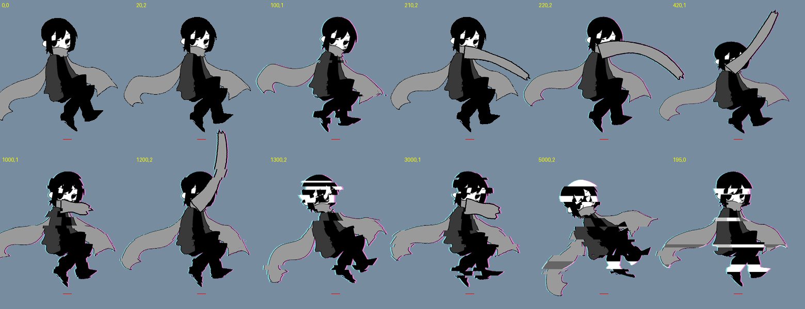

# 電子 独 (Denshi Doku) — MUGEN 1.1 character

A floating glitch entity who trades its own HP for power.

- `DenshiDoku/` — the character folder. Copy it into MUGEN 1.1's `chars/` and add
  `DenshiDoku/DenshiDoku.def` to `data/select.def`. Controls and the move list are in
  `DenshiDoku/readme.txt` (in Japanese).
- `source/denshi_doku.png` — the original illustration that every sprite is generated from.
- `tools/` — the Python build scripts (needs Pillow and numpy):
  - `build_sprites.py` builds `DenshiDoku.sff` and `DenshiDoku.air`
  - `build_states.py` builds `attacks.st`
  - `build_sounds.py` builds `DenshiDoku.snd`
  - `lint.py` checks that every anim, state, sound and sprite reference resolves
  - `preview.py` renders contact sheets of the built sprites

```bash
cd mugen/tools && python3 build_sprites.py && python3 build_states.py && python3 build_sounds.py && python3 lint.py
```


